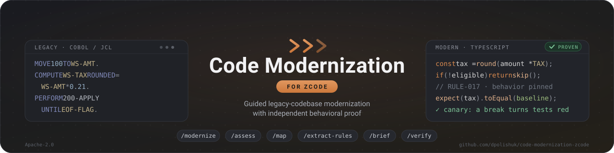

<p align="center">
  
</p>

# code-modernization — ZCode port workspace

This workspace holds a ZCode port of Anthropic's
[code-modernization](https://github.com/anthropics/claude-plugins-official/blob/main/plugins/code-modernization/README.md)
Claude Code plugin (Apache 2.0).

```
plugins/
  marketplace.json              local dev marketplace catalog (dev-code-modernization)
  code-modernization/           the plugin itself — see its README.md
    .zcode-plugin/plugin.json   manifest (commands only; no hooks by design)
    commands/                   13 slash commands (modernize, preflight, assess, …)
    agents/                     8 specialist agents (legacy-analyst, security-auditor, …)
    workflows/                  6 ZCode dynamic-workflow scripts (extract-rules, uplift-migrate, …)
    scripts/                    upstream Python evidence tools (proof_pack, compare, …)
    assets/                     report template + interactive topology viewer (+ vendored mermaid)
```

To install: `git clone https://github.com/dpolishuk/code-modernization-zcode.git`, then in ZCode
open **Plugin Marketplace → Add → Add Plugin Marketplace** and paste the clone's `plugins/`
directory, then install **Code Modernization** under
**Personal → dev-code-modernization**. Start with `/code-modernization:modernize`.

**Full step-by-step guide — installing, your first modernization end to end, what every
command produces, where you decide, troubleshooting:** [docs/usage.md](docs/usage.md)

Port notes (what changed from the Claude Code original and why) are in
[plugins/code-modernization/README.md](plugins/code-modernization/README.md).
The README banner lives in [docs/banner.svg](docs/banner.svg) — how to reuse or adapt it:
[docs/banner.md](docs/banner.md).
